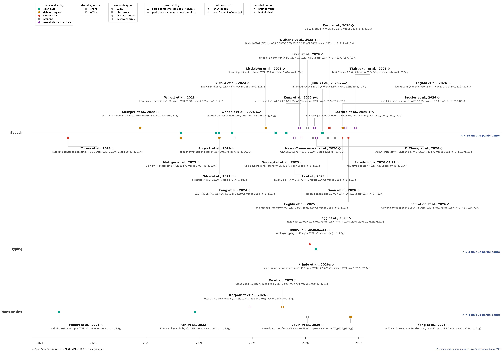

# Living Timeline of Communication Neuroprostheses (`communication-neuroprostheses-timeline`)

**English** | [简体中文 (`README.zh-CN.md`)](README.zh-CN.md)

A **weekly-updated, open-source living benchmark and timeline** of intracortical and electrocorticographic (ECoG) communication neuroprostheses—spanning **speech**, **typing**, and **handwriting**—for people with paralysis (2021–present).



- **Vector PDF (TrueType Type-42 embedded)**: [`communication_neuroprostheses_timeline.pdf`](communication_neuroprostheses_timeline.pdf)
- **Interactive HTML edition (single file, no dependencies)**: [`communication_neuroprostheses_timeline.html`](communication_neuroprostheses_timeline.html) — **live at <https://physics-lee.github.io/communication-neuroprostheses-timeline/>** (GitHub Pages). Click the in-figure legends or the filter chips to toggle study classes (data availability incl. preprint/reanalysis, brain-to-voice vs. brain-to-text, online vs. offline, electrode type, speech ability, task instruction, lane; plus free-text search). `Decoded output` and `Task instruction` expose exactly two options each; studies marked `both` remain visible while either option is on. Three layout modes (**Dim** by default, **Reflow**, **Hide in place**). A left-to-right build-in animation sweeps the study markers, leader lines, and cards onto the timeline on first load and whenever the timeline enters full screen (button or `F`; skipped when the OS requests reduced motion). Cohort counts (`n = … unique participants`) update live, an interactive Table 1 cohort overview (all 20 implanted participants, clickable to filter by participant) and an interactive SVG of the benchmark overview (Panels a–d: 32-study vocabulary funnel, open-sourced dataset size, online WER, and online speed) sit directly below the timeline, followed by the selected-study spotlight and the study cards, and clicking any timeline card or benchmark bar opens a standalone study card reporting all 6 legend dimensions, participants, and the four structured metrics (`vocab_size`, `sentences`, `wer`, `speed`) with DOI / dataset links.
- **Structured dataset (YAML primary + auto-synced JSON)**: [`studies.yaml`](studies.yaml) · [`studies.json`](studies.json)
- **Standalone layout & verification engine**: [`render_timeline.py`](render_timeline.py)
- **Weekly literature & preprint patrol**: [`weekly_patrol.py`](weekly_patrol.py)
- **Automated CI/CD**: [`.github/workflows/weekly_update.yml`](.github/workflows/weekly_update.yml)
- **AI Agent & contributor guide**: [`AGENTS.md`](AGENTS.md)

---

## 1. Visual Encoding Specification (6 Dimensions + 4 Structured Metrics)

Every study in [`studies.yaml`](studies.yaml) is encoded across **six orthogonal visual dimensions** plus a **four-item structured `metrics` block** (`vocab_size`, `sentences`, `wer`, `speed`), validated programmatically before rendering:

| Dimension | Field in `studies.yaml` | Visual Encoding | Allowed Values |
|---|---|---|---|
| **1. Data availability** | `data_availability` | Marker color + vertical track position (`open` sits directly on the track line; all other classes hang `0.52` units toward their label side) | `open` (`#00A087` teal) · `on_request` (`#c07f00` amber) · `closed` (`#cc3324` red) · `preprint` (`#7F7F7F` gray) · `reanalysis` (`#7B3294` purple) |
| **2. Decoding mode** | `decoding_mode` | Marker fill | `online` (solid fill = real-time closed-loop participant demo) · `offline` (hollow center with thick colored ring = offline analysis / reanalysis) |
| **3. Electrode type** | `electrode` | Marker shape | `ecog` (`o` circle) · `utah` (`s` square) · `thin_film` (`h` hexagon, e.g., Neuralink N1) · `microwire` (`v` down-triangle, e.g., Paradromics Connexus) |
| **4. Speech ability** | `participants` suffix | Triangle suffix after each participant ID | `▲` = participants who can speak naturally · `△` = participants who have vocal paralysis (dysarthria / anarthria / locked-in syndrome) |
| **5. Task instruction** | `task_instruction` | Lozenge suffix on line 1 (citation line) | `inner` (`◆` inner speech) · `intended` (`◇` overt / mouthing / intended movement) · `both` (`◆/◇` decoded under both instructions) |
| **6. Decoded output** | `decoded_output` | Pentagon suffix on line 2 (after descriptor) | `voice` (`⬟` direct neural-to-voice synthesis) · `text` (`⬠` brain-to-text, including optional TTS read-aloud of decoded text) · `both` (`⬟/⬠` both demonstrated) |

### Starred Studies (`★`)
A `★` prefixes the citation of every study satisfying **all five** starred-criterion terms: **open data**, **online (closed-loop) decoding**, **vocabulary > 71.4k** word forms, **online WER < 12.8%**, and **at least one participant with vocal paralysis (`△`)**. Currently two studies qualify: **Card et al., 2024** (T15) and **Jude et al., 2026a** (T17/T18). The criterion key is printed at the bottom left of both editions (`★ Open Data, Online, Vocab > 71.4k, WER < 12.8%, Vocal paralysis`); the set lives in `STAR_IDS` in [`render_timeline.py`](render_timeline.py) (a render-layer annotation, not a `studies.yaml` field).

### Four-Item `metrics` Schema
Each study records four standardized quantitative metrics under `metrics:`:
1. **`vocab_size`** (Vocabulary size): e.g., `"vocab 125k"`, `"open vocab"`, `"vocab 1,024"`, `"vocab 50"`, `"vocab n/r"`.
2. **`sentences`** (Sentence / trial count & data volume): training and evaluation corpus volume (e.g., `"10,880 sentences (24 sessions: 9,680 labeled train/val + 1,200 competition test)"`).
3. **`wer`** (Error rate): headline word, character, phoneme, or naive-listener error rate (e.g., `"WER 23.9%"`, `"listener WER 20%"`, `"CER 8.9% (WER n/r)"`).
4. **`speed`** (Communication speed): communication rate in words or characters per minute (e.g., `"62 wpm"`, `"110 cpm"`, `"n/r"`).

### Date Convention (`date` Field)
Because the timeline includes three distinct entry types (peer-reviewed journal articles, preprints/conference papers, and company announcements), `date` follows three unambiguous rules:

1. **Published Journal Articles**: Use the journal's official **Issue Date** (for online-only journals without print issues, such as *Nat. Commun.* or *Adv. Sci.*, use the sole **Article Publication Date**).
2. **Preprints & Conference Papers**: Use the preprint posting date or the conference proceedings publication date.
3. **Company Announcements**: Use the official announcement release date (with the card header formatted directly as `Name, yyyy.mm.dd`).

---

## 2. Quick Start (Re-render Locally)

```bash
pip install -r requirements.txt
python render_timeline.py --yaml studies.yaml --out communication_neuroprostheses_timeline --check-overlaps
```

`render_timeline.py` performs:
1. **Schema & invariant gate checks**: verifies all 6 visual-encoding dimensions, all 4 `metrics` keys (`vocab_size`, `sentences`, `wer`, `speed`), green-on-track placement, and same-tier marker separation (`>= 0.045 yr`), and exports [`studies.json`](studies.json) automatically.
2. **Automatic cohort accounting**: deduplicates participant IDs per modality lane and across the full figure (resolving re-implant aliases such as `B1r -> B1`).
3. **Two-pass layout solver**: estimates text widths in pass 1, measures exact pixel bounding boxes from the renderer in pass 2, packs cards with staggered vertical stems and horizontal rails, and equalizes inter-legend gaps to `<= 0.5 px`.
4. **Zero-overlap gate**: checks every pairwise text and legend bounding box and fails closed if any pair overlaps by `> 1 px`.

---

## 3. Weekly Update Workflow

### Automated Weekly Patrol (`weekly_patrol.py`)
Every Monday (`0 9 * * 1`), the patrol script runs two automated checks:
1. **Preprint-to-journal graduation check**: queries the Crossref API (`is-preprint-of` relations) for every `preprint` card in `studies.yaml` to detect when a bioRxiv/medRxiv preprint is formally published in a peer-reviewed journal.
2. **New literature discovery**: queries Europe PMC (covering PubMed, bioRxiv, and medRxiv) and the arXiv API over the past 7 days for new intracortical/ECoG speech, typing, and handwriting neuroprosthesis demonstrations, and generates ready-to-paste `studies.yaml` templates.

```bash
python weekly_patrol.py --days 7 --output weekly_candidates.md
```

### Adding a New Study (Community Pull Requests Welcome)
Append an entry to [`studies.yaml`](studies.yaml) and run `python render_timeline.py`:

```yaml
  - id: author2026
    citation: "Author et al., 2026"
    date: "2026-11-06"
    lane: speech                  # speech | typing | handwriting
    electrode: utah               # utah | ecog | thin_film | microwire
    data_availability: open       # open | on_request | closed | preprint | reanalysis
    decoding_mode: online         # online | offline
    task_instruction: intended    # inner | intended | both
    decoded_output: text          # voice | text | both
    descriptor: "large-vocab decoding"
    metrics:
      vocab_size: "vocab 125k"
      sentences: "10,000 sentences (20 sessions)"
      wer: "WER 5.0%"
      speed: "62 wpm"
    participants: ["T15△"]
    doi: "10.1038/..."
```
