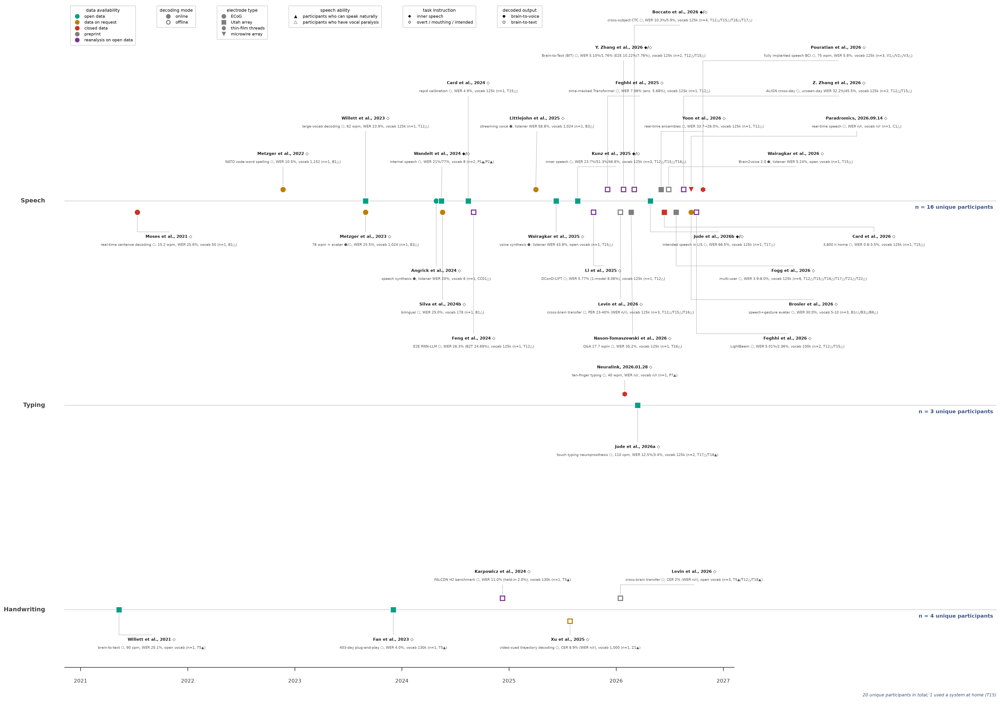

# 通信神经假体动态时间线 (`communication-neuroprostheses-timeline`)

[English (`README.md`)](README.md) | **简体中文**

面向瘫痪患者的皮层内（Intracortical）与皮层脑电（ECoG）**通信神经假体开源动态基准与时间线**（涵盖**语音解码 Speech**、**打字 Typing** 与**手写 Handwriting** 三大模态，收录 2021 年至今的代表性研究与临床进展，每周自动巡检更新）。



- **矢量 PDF（内嵌 TrueType Type-42 字体）**：[`communication_neuroprostheses_timeline.pdf`](communication_neuroprostheses_timeline.pdf)
- **交互式 HTML 版（单文件、零依赖）**：[`communication_neuroprostheses_timeline.html`](communication_neuroprostheses_timeline.html) — 点击图内图例或侧栏筛选器即可按任意维度切换研究显示（数据可用性含预印本/再分析、B2V 语音 vs. B2T 文本、实时 vs. 离线、电极类型、言语能力、任务范式、模态轨道，另支持自由文本搜索）。提供三种展示模式：**reflow 紧凑重排**（卡片围绕时间锚点重新装箱）、**hide 原位隐藏**、**dim 半透明淡出**；队列计数（`n = … unique participants`）实时联动。点击时间轴上任意小卡片即可展开该研究的独立详情卡，完整汇报 6 个图例维度、受试者信息与四项结构化指标（`vocab_size` 词库大小、`sentences` 数据量、`wer` 词错率、`speed` 速度），并附论文 / 数据集 DOI 直达链接。
- **结构化数据集（YAML 主数据源 + 自动同步 JSON）**：[`studies.yaml`](studies.yaml) · [`studies.json`](studies.json)
- **独立排版与校验引擎**：[`render_timeline.py`](render_timeline.py)
- **每周文献与预印本自动巡检脚本**：[`weekly_patrol.py`](weekly_patrol.py)
- **自动化 CI/CD 工作流**：[`.github/workflows/weekly_update.yml`](.github/workflows/weekly_update.yml)
- **AI 协作者与维护者指南**：[`AGENTS.md`](AGENTS.md)

---

## 1. 视觉编码规范（6 个正交维度 + 4 项结构化指标）

[`studies.yaml`](studies.yaml) 中的每个条目均在**六个正交视觉维度**及**四项结构化 `metrics` 指标**（`vocab_size`、`sentences`、`wer`、`speed`）上进行编码，并在渲染前通过程序化校验：

| 维度 | `studies.yaml` 字段 | 视觉编码方式 | 允许取值 |
|---|---|---|---|
| **1. 数据可用性** | `data_availability` | 标记点颜色 + 轨道垂直位置（`open` 直接落在时间轨道线上；其余类别向各自标签侧悬挂 `0.52` 单位） | `open`（`#00A087` 青绿）· `on_request`（`#c07f00` 琥珀黄）· `closed`（`#cc3324` 红）· `preprint`（`#7F7F7F` 灰）· `reanalysis`（`#7B3294` 紫） |
| **2. 解码模式** | `decoding_mode` | 标记点填充样式 | `online`（实心填充 = 实时闭环受试者演示）· `offline`（空心白底配粗彩环 = 离线分析 / 重分析） |
| **3. 电极类型** | `electrode` | 标记点几何形状 | `ecog`（`o` 圆形）· `utah`（`s` 正方形）· `thin_film`（`h` 六边形，如 Neuralink N1）· `microwire`（`v` 倒三角形，如 Paradromics Connexus） |
| **4. 言语能力** | `participants` 后缀 | 受试者编号后的三角形后缀 | `▲` = 具备自然发声能力的受试者 · `△` = 言语瘫痪受试者（构音障碍 / 失语 / 闭锁综合征） |
| **5. 任务范式** | `task_instruction` | 第 1 行（文献引用行）末尾菱形后缀 | `inner`（`◆` 内部言语 / 默念）· `intended`（`◇` 尝试发声 / 口型 / 意图运动）· `both`（`◆/◇` 两种范式均进行了验证） |
| **6. 解码输出** | `decoded_output` | 第 2 行（方法简述后）末尾五边形后缀 | `voice`（`⬟` 直接神经到语音合成）· `text`（`⬠` 脑到文本解码，含可选的解码文本 TTS 朗读）· `both`（`⬟/⬠` 两种输出均进行了演示） |

### 四项结构化指标（`metrics` Schema）
每项研究在 `metrics:` 下统一记录四项定量指标：
1. **`vocab_size`**（词表规模）：如 `"vocab 125k"`、`"open vocab"`、`"vocab 1,024"`、`"vocab 50"`、`"vocab n/r"`。
2. **`sentences`**（句子/试次数量与数据量）：训练与评测语料规模，如 `"10,880 sentences (24 sessions: 9,680 labeled train/val + 1,200 competition test)"`。
3. **`wer`**（错误率）：核心词错误率（WER）、字符错误率（CER）、音素错误率（PER）或听力测试错误率，如 `"WER 23.9%"`、`"listener WER 20%"`、`"CER 8.9% (WER n/r)"`。
4. **`speed`**（通信速率）：每分钟词数（wpm）或每分钟字符数（cpm），如 `"62 wpm"`、`"110 cpm"`、`"n/r"`。

### 日期规则（`date` 字段）
因为时间线里包含三类条目（正式期刊论文、预印本/会议论文、公司公告），最干净、无懈可击的三条日期规则是：

1. **已发表期刊论文（Published Journal Articles）**：统一用期刊正式刊期日（**Issue Date**）（若为纯电子刊无纸质期号，如 *Nat. Commun.* / *Adv. Sci.*，则用其唯一的文章发表日 **Article Publication Date**）。
2. **预印本与会议论文（Preprints & Conference Papers）**：用预印本上线日或会议论文集出版日。
3. **非论文公司发布（Company Announcements）**：用官方公告发布日（且卡片标题直接印出 `Name, yyyy.mm.dd`）。

---

## 2. 快速开始（本地重新渲染）

```bash
pip install -r requirements.txt
python render_timeline.py --yaml studies.yaml --out communication_neuroprostheses_timeline --check-overlaps
```

`render_timeline.py` 会自动执行以下步骤：
1. **Schema 与不变量门禁校验**：检查全部 6 个视觉编码维度、4 个 `metrics` 键（`vocab_size`、`sentences`、`wer`、`speed`）、开源绿色标记压线规则、同层标记点最小间距（`>= 0.045 yr`），并自动导出同步 [`studies.json`](studies.json)。
2. **受试者队列自动去重统计**：按模态泳道及全图范围对受试者编号自动去重计数（自动合并重植入别名，如 `B1r -> B1`）。
3. **两阶段排版求解器**：第一阶段估算文本宽度，第二阶段从渲染器读取精确像素包围盒，自动排布交错垂直引线与水平导轨，并将图例间距均分控制在 `<= 0.5 px` 以内。
4. **零重叠门禁（Zero-overlap gate）**：两两检查所有文本卡片与图例的像素包围盒，若存在任何 `> 1 px` 的重叠则直接报错退出。

---

## 3. 每周更新工作流

### 自动化每周文献巡检（`weekly_patrol.py`）
每周一（`0 9 * * 1`），巡检脚本会自动运行两项检查：
1. **预印本转正检查**：针对 `studies.yaml` 中所有 `preprint` 条目查询 Crossref API（`is-preprint-of` 关系），自动检测 bioRxiv/medRxiv 预印本是否已在同行评审期刊正式发表。
2. **新文献发现**：查询过去 7 天内 Europe PMC（覆盖 PubMed、bioRxiv、medRxiv）与 arXiv API 中新发表的皮层内/ECoG 语音、打字与手写神经假体研究，并生成可直接粘贴至 `studies.yaml` 的条目模板。

```bash
python weekly_patrol.py --days 7 --output weekly_candidates.md
```

### 添加新研究（欢迎提交 Pull Request）
在 [`studies.yaml`](studies.yaml) 末尾追加条目并运行 `python render_timeline.py`：

```yaml
  - id: author2026
    citation: "Author et al., 2026"
    date: "2026-11-06"
    lane: speech                  # speech | typing | handwriting
    electrode: utah               # utah | ecog | thin_film | microwire
    data_availability: open       # open | on_request | closed | preprint | reanalysis
    decoding_mode: online         # online | offline
    task_instruction: intended    # inner | intended | both
    decoded_output: text          # voice | text | both
    descriptor: "large-vocab decoding"
    metrics:
      vocab_size: "vocab 125k"
      sentences: "10,000 sentences (20 sessions)"
      wer: "WER 5.0%"
      speed: "62 wpm"
    participants: ["T15△"]
    doi: "10.1038/..."
```
